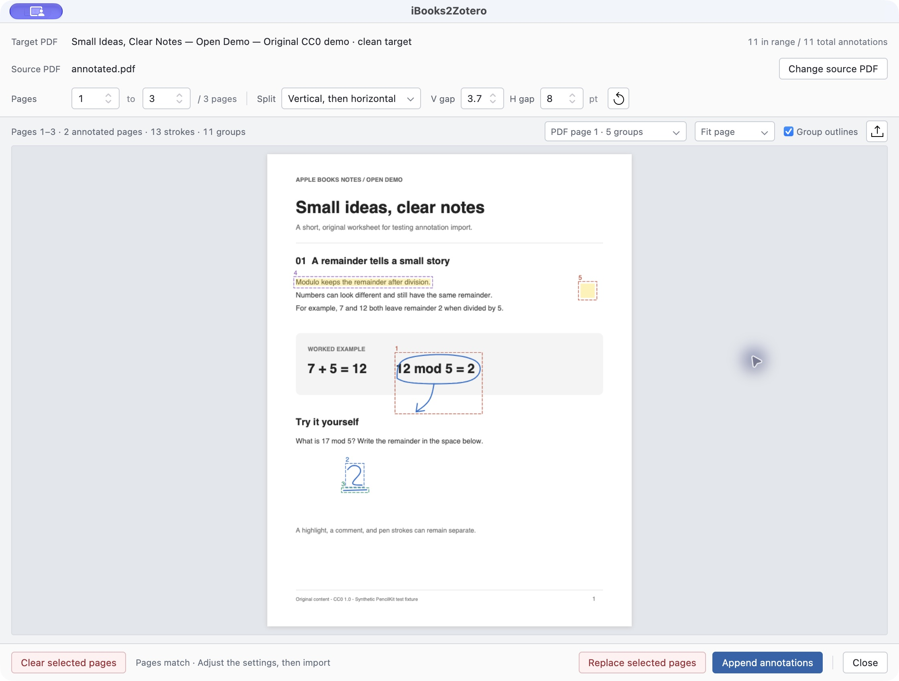
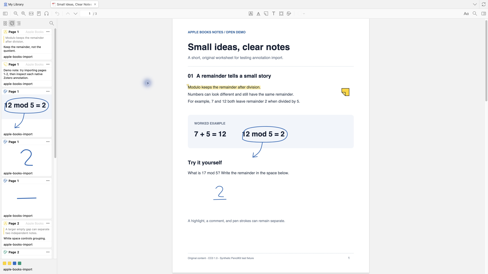

# iBooks2Zotero

**English** | [简体中文](README.zh-CN.md)

Bring handwritten notes, highlights, and comments from an Apple Books PDF into Zotero as **editable native annotations**.

**macOS · Zotero 10.0.x · English & Chinese · Local processing**



## Features

- Import PencilKit pen strokes, standard PDF highlights, and text notes from an annotated PDF or a supported annotation ZIP.
- Preserve stroke positions and colors; split handwriting into useful annotation groups.
- Adjust vertical/horizontal gap thresholds and splitting order with a live preview.
- Import or clear an inclusive PDF page range. Append annotations or replace selected pages.
- Check source/target page counts, content fingerprints, dimensions, and rotation before importing.
- Follow Zotero's interface language automatically, falling back to the system language when unavailable. Chinese locales use Simplified Chinese; other languages use English.
- Process files locally and export a compact, re-importable annotation ZIP. No account or API key required.

## Install

1. Download `iBooks2Zotero-0.6.0.xpi` from [Releases](https://github.com/jmm1960/iBooks2Zotero/releases).
2. In Zotero, open **Tools → Plugins**, then use the gear menu → **Install Plugin From File** and select the XPI.
3. Open a target PDF, or select its item/attachment, then choose **Tools → iBooks2Zotero…**. The item context menu also has this command.

Tested with Zotero **10.0.9** on macOS. The parser includes Apple Silicon and Intel architectures. Windows and Linux are not supported. Installed users do not need Python, Node.js, or Xcode.

## Use: from Apple Books to Zotero

1. **Export from Apple Books.** On iPhone/iPad, go to **Books → Library → More (…) below the PDF → Share**, then send the PDF to your Mac with AirDrop or save a copy through the share sheet. Older versions may show Share while the PDF is open. See [Apple's iPad PDF guide](https://support.apple.com/en-qa/guide/ipad/ipadca8ec5ef/ipados).
2. **Check the exported PDF.** Confirm your handwriting/highlights are visible. Share the PDF itself; avoid printing, flattening, or exporting screenshots, which can discard the editable stroke data.
3. **Prepare the target.** Add the matching, unannotated PDF edition to Zotero and select/open that attachment.
4. **Choose the source.** Open **iBooks2Zotero… → Choose source** and select the annotated PDF or annotation ZIP. It parses automatically.
5. **Review.** Set the page range and inspect the groups. Defaults: vertical first, then horizontal; **3.7 pt** vertical gap, **8 pt** horizontal gap. Larger gaps merge more strokes.
6. **Import.** Choose **Append annotations** to keep existing annotations, or **Replace selected pages** to clear that range before importing. Open the Zotero reader to edit the results.

**Clear/Replace deletes all native Zotero annotations in the selected pages, including ones you created in Zotero.** Both ask for confirmation. Other pages, standalone library notes, and annotations embedded in the PDF are preserved. There is no duplicate detection or plugin import history; repeated appends create duplicates.

Page numbers follow physical PDF order, include both endpoints, and may differ from printed page labels. **Export annotation ZIP** preserves original source annotation objects and their dependencies, regardless of the import range. The ZIP can be selected as a source later; the matching target PDF is still required.

## Raw annotation ZIPs

- Export preserves original PDF annotation dictionaries, opaque Apple drawing archives, unknown/private fields, and referenced appearance/resource streams. It does not decode, sample, split, or redraw handwriting.
- ZIPs contain `manifest.json`, `annotations.pdf` (annotation objects on blank pages), and `README.txt`. Original page order, geometry, and matching fingerprints are recorded. Book page content is excluded.
- Select the ZIP as a source alongside the matching target PDF in Zotero. Parsing and grouping happen then, using the current algorithm. Unsupported annotation data remains in the ZIP even if the current converter cannot import it.
- Export is available after the source archive is prepared, including when conversion or target matching fails. Exporting an imported ZIP preserves its payload unchanged, regardless of range/group settings.
- Previous experimental ZIP formats are intentionally unsupported. Re-export from the annotated source PDF.
- Annotation graphs and compressed stream bytes are verified before export. PDF object numbers/container serialization change; this is not a byte-identical backup of the original PDF and does not preserve its valid digital signatures. See [the format](docs/BUNDLE-FORMAT.md).

## Demo & screenshots

Use [demo/clean.pdf](demo/clean.pdf) as the target and either [demo/annotated.pdf](demo/annotated.pdf) or [demo/annotations.zip](demo/annotations.zip) as the source. The original three-page worksheet contains 13 pen strokes, 2 highlights, and 1 note; default grouping imports **11 native annotations**. Page 3 deliberately has no annotations.

The PencilKit data is **synthetic**, wrapped in the archive structure consumed by the parser; this is not an actual Apple Books export. The original PDF content and annotations are dedicated under **CC0 1.0**. See [demo instructions and licensing](demo/README.md).



## Build & test

Requires macOS, Xcode Command Line Tools, Node.js, and system `zip`, `lipo`, and `codesign`. No npm install is required; MIT-licensed pdf-lib is vendored (see [third-party notices](THIRD_PARTY.md)).

```sh
npm test
npm run build
node scripts/check-raw-roundtrip.cjs
```

Output: `dist/iBooks2Zotero-0.6.0.xpi`. The native helper uses an ad-hoc signature; it is not Apple-notarized. Rebuild the original demo with `PYTHON=path/to/python npm run demo` after installing [the demo dependencies](scripts/demo-requirements.txt).

- `src/`: plugin, compact UI, localization catalog, and geometry core.
- `src/native/`: Swift PDFKit/PencilKit parser.
- `scripts/`, `tests/`: reproducible builds, demo generation, and regression tests.
- `demo/`, `docs/images/`: original fixtures and real application screenshots.

Chinese source strings are confined to `src/i18n.js`; documentation has a separate Chinese edition. The extension ID and preferences retain their original names so existing installations upgrade normally. Updates are manual; the manifest's `example.invalid` URL is only a placeholder.

## Limits & privacy

- Flattened/image-only handwriting cannot be restored. Generic PDF Ink without the Apple drawing archive is not currently supported.
- Rotated pages are not supported. Different PDF editions or mismatched pages block import.
- Grouping uses geometric gaps, not meaning. Width is approximated per group; pressure, pen texture, and eraser masks may not transfer exactly. Large groups may be split for Zotero's size limit.
- The Apple archive is a best-effort compatibility format, not a stable official interchange API. Check previews with your own exported files.
- Files are not uploaded. Only grouping preferences persist; the parser is cached under the Zotero profile, and temporary parse results are removed after reading. No automatic source backup is created.

## Contributing & license

See [CONTRIBUTING.md](CONTRIBUTING.md). Report issues with app versions, reproduction steps, and a small shareable PDF; do not upload private notes or copyrighted books without permission.

Code: [MIT](LICENSE). Original demo content: [CC0 1.0](demo/LICENSE). Independent project; not affiliated with Apple or Zotero.
