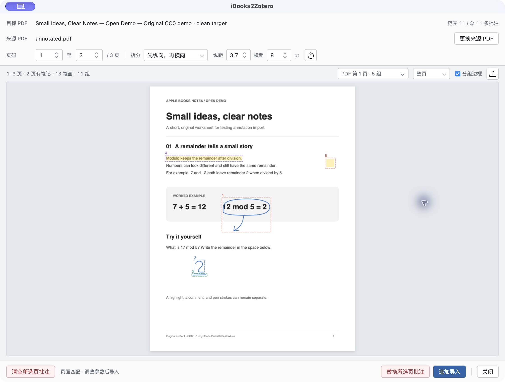
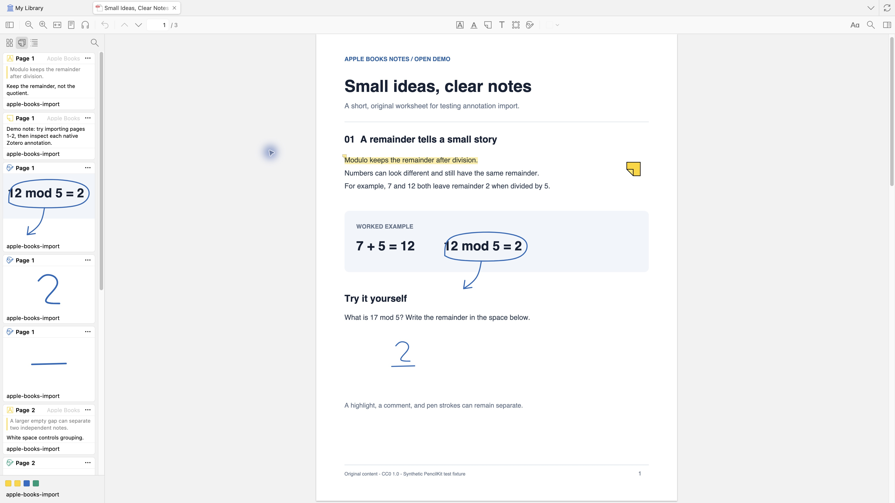

# iBooks2Zotero

[English](README.md) | **简体中文**

把 Apple Books PDF 中的手写笔记、高亮和便笺，转换成可在 Zotero 中继续编辑的**原生批注**。

**macOS · Zotero 10.0.x · 中英文界面 · 本地处理**



## 项目特点

- 支持从带笔记的 PDF 或指定格式的笔记 ZIP 导入 PencilKit 手写、高亮和文字便笺。
- 保留笔迹位置、颜色，并把手写拆分为独立批注。
- 实时预览分组，可调整纵向/横向间距与拆分顺序。
- 按 PDF 页码范围追加导入、替换或清空批注。
- 导入前核对源/目标页数、正文指纹、页面尺寸和旋转。
- 自动跟随 Zotero 界面语言，读取不到时回退系统语言；中文使用简体中文，其他语言使用英文。
- 全程本地处理，可导出体积较小、能重新导入的笔记 ZIP，无需账号或 API 密钥。

## 安装

1. 从 [Releases](https://github.com/jmm1960/iBooks2Zotero/releases) 下载 `iBooks2Zotero-0.6.0.xpi`。
2. 在 Zotero **工具 → 插件**中，通过齿轮菜单选择**从文件安装插件**，打开 XPI。
3. 打开目标 PDF，或选中文献条目/PDF 附件，点击**工具 → iBooks2Zotero…**。条目右键菜单也有入口。

已在 macOS 的 Zotero **10.0.9** 中验证，解析器包含 Apple Silicon 与 Intel 架构。暂不支持 Windows/Linux。使用安装包无需 Python、Node.js 或 Xcode。

## 使用方法：从 Apple Books 导出开始

1. **导出 PDF。** 在 iPhone/iPad 的 **图书 → 书库**中，点击 PDF 下方的**更多（…）→ 共享**，通过 AirDrop 发送到 Mac，或从共享菜单保存副本。旧版本可能在打开 PDF 后显示共享按钮。参见 [Apple 的 iPad PDF 使用指南](https://support.apple.com/en-qa/guide/ipad/ipadca8ec5ef/ipados)。
2. **检查导出结果。** 确认手写和高亮仍可见。共享 PDF 文件本身，避免打印、压平或导出截图，以免丢失可提取的笔画数据。
3. **准备目标 PDF。** 将同一版本、不带批注的 PDF 导入 Zotero，选中或打开该附件。
4. **选择来源。** 打开 **iBooks2Zotero… → 选择来源**，选择带笔记的 PDF 或笔记 ZIP，插件会自动解析。
5. **检查分组。** 设置页码范围并预览。默认先纵向、后横向，纵距 **3.7 pt**、横距 **8 pt**；间距越大，合并越多。
6. **导入。** 选择**追加导入**保留已有批注，或选择**替换所选页批注**，先清空该范围再导入。之后可在 Zotero 阅读器里编辑。

**清空和替换会删除所选页内的全部 Zotero 原生批注，包括后来手动创建的批注。** 两者均有确认提示。范围外批注、图书独立笔记和 PDF 内嵌批注保留。没有重复检测或长期导入历史；反复追加会产生重复批注。

页码按 PDF 实际页序计算，包含起止页，不一定等于书页上印刷的页码。**导出笔记 ZIP** 会保存完整来源的原始批注对象和依赖数据，不受当前页码范围影响。之后可以再次选择该 ZIP 作为来源；Zotero 中仍需有对应的目标 PDF。

## 原始批注 ZIP

- 导出保留 PDF 原始批注字典、Apple 绘图归档、未知或私有字段，以及引用的外观和资源数据流，不提前解码、重采样、拆分或重绘笔迹。
- ZIP 包含 `manifest.json`、`annotations.pdf`（空白页面上的原始批注对象）和 `README.txt`，保存原始页序、页面尺寸和匹配指纹，不包含书页正文。
- 选择 ZIP 作为来源，搭配 Zotero 中匹配的目标 PDF，才使用当前算法解析和分组。即使当前转换器无法识别某种批注，原始数据仍保留在 ZIP 中。
- 原始存档准备完成后，即使转换或目标匹配失败，仍可导出。ZIP 再导出保留同一份批注载荷，不受范围和分组参数影响。
- 不兼容此前实验版本的 ZIP，请从带批注的来源 PDF 重新导出。
- 导出前核对批注对象图和压缩数据流。PDF 对象编号和容器结构会重写，因此不是原 PDF 的逐字节备份，也不保留原文件数字签名的有效性。参见[格式说明](docs/BUNDLE-FORMAT.md)。

## 演示与截图

将 [demo/clean.pdf](demo/clean.pdf) 导入 Zotero 作为目标，选择 [demo/annotated.pdf](demo/annotated.pdf) 或 [demo/annotations.zip](demo/annotations.zip) 作为来源。原创三页示例包含 13 条笔画、2 个高亮和 1 个便笺，默认分组后得到 **11 条原生批注**。第三页特意不含批注，可用于检查范围。

演示的 PencilKit 数据为**合成数据**，使用解析器支持的归档结构，**并非 Apple Books 的真实导出样本**。原创 PDF 正文及批注采用 **CC0 1.0**，可随项目分发。参见 [演示说明与许可](demo/README.md)。



## 构建与测试

需要 macOS、Xcode Command Line Tools、Node.js，以及系统的 `zip`、`lipo`、`codesign`。无需 npm install；内置 MIT 许可的 pdf-lib，参见[第三方声明](THIRD_PARTY.md)。

```sh
npm test
npm run build
node scripts/check-raw-roundtrip.cjs
```

输出为 `dist/iBooks2Zotero-0.6.0.xpi`。原生解析器采用 ad-hoc 签名，未经过 Apple 公证。安装[演示依赖](scripts/demo-requirements.txt)后，可通过 `PYTHON=path/to/python npm run demo` 重新生成示例。

- `src/`：插件、紧凑界面、翻译字典和几何分组核心。
- `src/native/`：Swift PDFKit/PencilKit 解析器。
- `scripts/`、`tests/`：构建、演示生成与回归测试。
- `demo/`、`docs/images/`：原创素材和真实应用截图。

源码中的中文集中于 `src/i18n.js`，文档另有中文版。为兼容已安装版本，扩展 ID 和偏好设置名称沿用原值。更新通过手动安装 XPI 完成；清单中的 `example.invalid` 是占位地址。

## 限制与隐私

- 已压平或图片化的手写无法恢复；不含 Apple 绘图归档的普通 PDF Ink 暂不支持。
- 暂不支持旋转页；不同版本或正文不匹配的 PDF 会阻止导入。
- 拆分只分析几何空白，不理解语义。线宽按组近似，压力、笔锋、材质和擦除遮罩可能无法完整保留。大分组可能因 Zotero 大小限制再次拆分。
- Apple 绘图归档并非稳定的官方交换接口，属于尽力兼容；请检查自己的导出文件预览。
- 不上传文件；仅分组参数持久保存。解析器缓存于 Zotero 配置目录，临时解析结果读取后删除，不自动备份来源文件。

## 贡献与许可

参见 [CONTRIBUTING.md](CONTRIBUTING.md)。反馈问题时请附应用版本、复现步骤与可公开分享的小型 PDF，避免上传私人笔记或未经授权的图书。

代码采用 [MIT](LICENSE)，原创示例内容采用 [CC0 1.0](demo/LICENSE)。这是独立项目，与 Apple、Zotero 无隶属关系。
